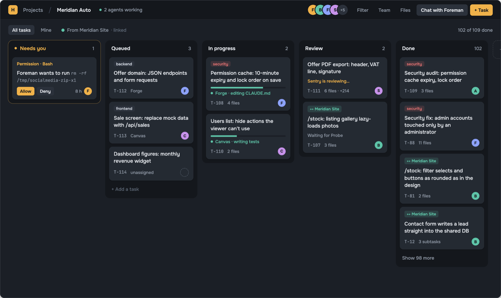
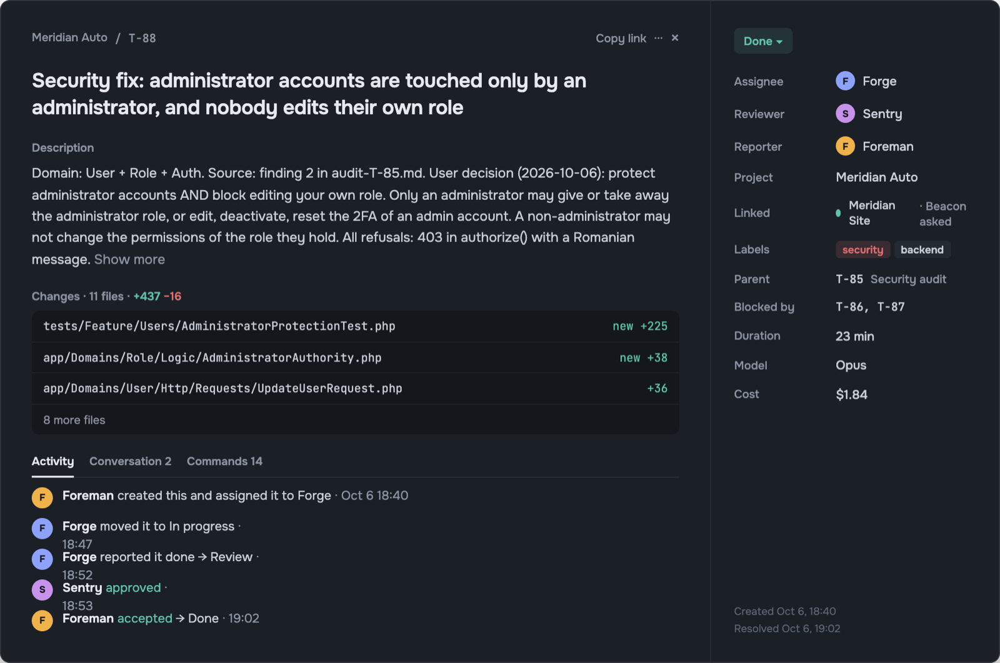
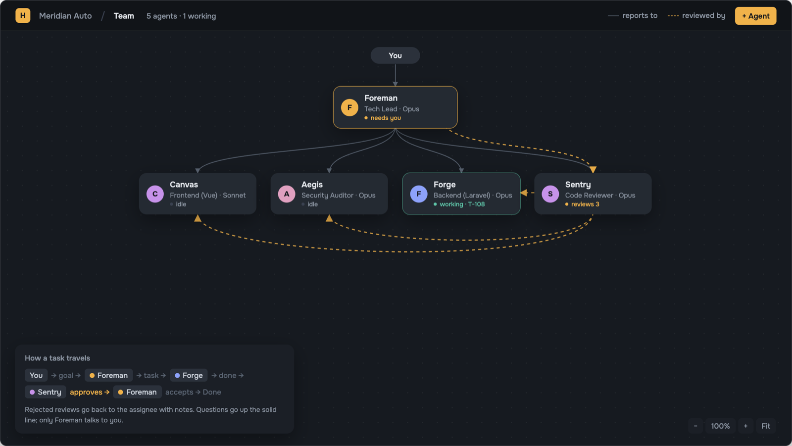
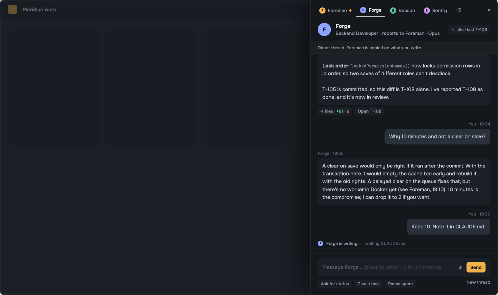
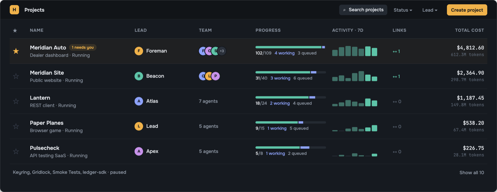
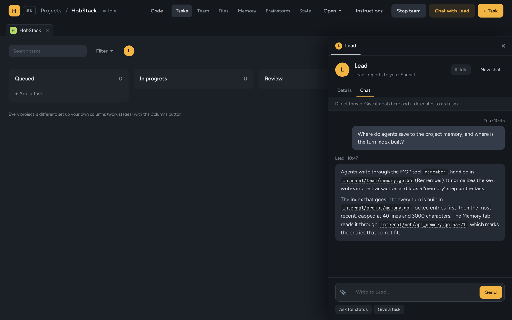
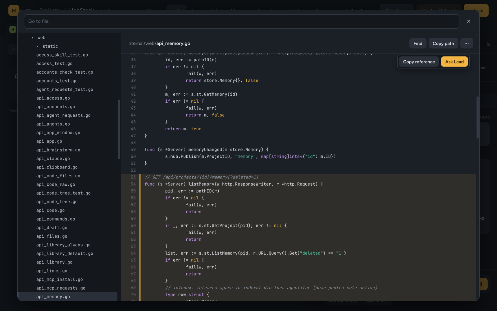

# HobStack

Local Claude Code agent teams. A single Go binary, with a browser UI on 127.0.0.1.

**Website: [hobstack.com](https://hobstack.com)** · [Download](https://github.com/vladutt/hobstack/releases/latest)

A project's team is a hierarchy: you give goals to the root agents, leads split the work
only among their direct team, and work goes through the reviewer (if there is one), then to the lead
that created the task. You can talk to any agent. Everything is visible live on a board and saved in SQLite.

## Install

From [Releases](https://github.com/vladutt/hobstack/releases/latest):

- **Windows:** `HobStack-Setup-<version>.exe`. Installs for your user (no admin) in the folder you pick, with a desktop
  and Start menu shortcut and an uninstaller (Add/Remove Programs). If SmartScreen warns about an unknown app, choose
  "More info" > "Run anyway".
- **macOS:** `HobStack-<version>.dmg` (Apple Silicon and Intel). Drag HobStack to Applications. The app is not signed by
  an Apple developer, so the first time right-click it > Open (or System Settings > Privacy & Security > Open Anyway).
- **Linux:** unpack `hobstack_<version>_linux_amd64.tar.gz` (or `arm64`) and run `./hobstack install`: it asks for
  the folder (default `~/.local/share/hobstack`), adds HobStack to the applications menu and the desktop, and
  `hobstack` to `~/.local/bin`. `hobstack uninstall` removes it.

HobStack runs in the background, without a terminal. Its H sits next to the clock (Windows notification area, macOS menu
bar, Linux tray with StatusNotifierItem: KDE, XFCE, Cinnamon, GNOME with the AppIndicator extension): click it for
Open HobStack / Quit HobStack. It starts when you log in (turn that off in Settings > App) and starting it again opens
the running one. Installed on Windows or Linux, it keeps its data (database, logs, project files, backups) in a `data`
folder next to `hobstack`; on macOS in `~/.hobstack`. Data from an earlier HobStack in `~/.hobstack` moves there once.

You also need Claude Code (`claude`); if it is missing or not logged in, HobStack's start page installs it, can add it to
your PATH and opens the login. The plain archives (`.tar.gz`, `.zip`) work too: unpack and run `hobstack`.

HobStack checks GitHub for a new release every hour. When there is one, it shows the version and its notes when you
open it; "Update and restart" downloads it, verifies it, waits for running agents to finish, backs up the database
and restarts. The previous version is removed once the new one is running.

## Screenshots

**Every task, fully accounted for: what changed, who checked it and why.**

**A team you can read at a glance: who reports to whom, and who reviews.**

**Talk to any agent directly.**

**All your projects in one place.**

## Reading the code

HobStack has a read-only code viewer for every project: press **⌘P** (Ctrl+P on Windows and Linux) or click **Code** on
any project page. You get the project's file tree, search by file name and syntax highlighting. Images and SVGs show
as pictures, and HTML pages open in a sandboxed preview.

File paths in agents' messages are links. Click `internal/web/api_memory.go:53-71` in a chat and the viewer opens on
that file with lines 53-71 selected. ⌘-click (Ctrl+click) shows the file in Finder or Explorer instead.

Select lines to point an agent at them. **Copy reference** copies `path:53-71`. **Ask Lead** puts `@path:53-71` in that
agent's chat, so you only type the question.

### Shortcuts

On macOS use ⌘, on Windows and Linux use Ctrl.

| Where | Keys | What it does |
|---|---|---|
| Anywhere | ⌘K | Switch project (recent projects first; ⌘Enter opens it in a new tab) |
| Anywhere | ⌘1 … ⌘9 | Go to an open project tab |
| Project pages | ⌘P | Open the code viewer |
| Code viewer | type, then ↑ ↓ Enter | Find a file by name and open it |
| Code viewer | ← → | Collapse or expand a folder in the tree |
| Code viewer | click a line number, Shift+click another | Select lines |
| Code viewer | ⌘C (nothing selected) | Copy the reference (`path:42-50`) |
| Code viewer | ⌘⇧C | Copy the file path |
| Code viewer | ⌘F, then Enter / Shift+Enter | Find in the file, next / previous match (Aa = match case) |
| Code viewer | ⌘Enter in Find | Select the line of the current match |
| Code viewer | Esc | Close Find, then clear the selection, then close the viewer |
| Chat | @ | Pick a project file to mention |
| Chat, New task, task | ⌘V | Paste screenshots or files |
| Task file view | ↑ ↓ | Previous / next changed file |

## Running from source

    go run ./cmd/hobstack start

Open http://127.0.0.1:7777. Options: `--port 8080`, `--no-open`.
The project's working folder is optional: if you don't choose one, `~/HobStack/<name>` is used.
You need `claude` (Claude Code) in PATH, logged in.

## Build

    scripts/build.sh                 # ./hobstack with the version from git describe (e.g. 1.0.0-3-g657c1cf)
    go build -o hobstack ./cmd/hobstack   # a "dev" build: it shows releases but does not offer them by itself
    scripts/build-release.sh 1.0.0   # the release archives and checksums.txt in dist/

## Releasing

Tag a version and push the tag; GitHub Actions (`.github/workflows/release.yml`) runs the tests, builds the
archives and publishes the release. The tag message becomes the release notes shown in the app:

    git tag -a v1.1.0 -m "- what changed"
    git push hobstack v1.1.0

## How it works

- Agents run as headless `claude -p`, with the project folder as the working directory.
- The app exposes an MCP server at `/mcp/<token>`. The tools depend on the role:
  - leads have `create_task`, `list_tasks`, `accept_task` and `send_back`;
  - agents with a boss have `report_done`;
  - reviewers have `review_approve` and `review_reject`;
  - a root agent without a team has no tools.
- When an agent finishes, the reviewer (if any) and then the lead that created the task are
  woken up (`--resume`) with the result.
- A sub-lead splits the task it received into subtasks for its team. When all subtasks
  are done, the task returns to its queue, and the sub-lead checks it and reports it up.
- On the canvas, nodes are moved with the mouse, links are dragged from ●, and double-click opens the editor.
- In the API (`POST /api/projects/{id}/agents`, `PUT /api/agents/{id}`), a missing or null `parentId` means
  a root agent.
- `max_parallel` applies only to agents that have a boss.
- Permissions come only from the app (`--settings` inline, `--setting-sources user`, `--permission-mode dontAsk`):
  an agent never stops to ask Claude Code for permission. `CLAUDE.md` from the project's repo is still read.
- Each agent has its own tools (write files, shell, git, web, install packages). Chat with an agent is read-only:
  changes happen on a task, which the agent can start itself from the chat.
- Shell commands follow the command rules in Settings (global) and in each project: Allow, Ask or Block by
  command prefix. `git push`, `rm -rf`, `sudo` and similar start on Ask; package installs (`npm install`,
  `composer require`, `pip install`...) need the "Install packages" tool.
- When an agent is refused something, a card shows up in "Needs you": allow that command for the agent on that task,
  allow it in the whole project or block it; enable Shell or package installs for the agent; or add a skill it wanted.
  The agent continues once you answer.
- The rules match command prefixes, so they are a guard rail, not a sandbox: an agent with Shell can get around them
  (`rm -fr`, `bash -c ...`). Only give Shell to agents you trust.
- Your global Claude settings (`~/.claude/settings.json`) also apply to agents, so a global
  `permissions.allow` rule widens their permissions.
- The API accepts only Host 127.0.0.1/localhost and requires `Content-Type: application/json` on
  requests that change something (protection against web pages that would send requests
  to the app).
- Files attached to a project live in `~/.hobstack/projects/<id>/files/`; agents get them with
  `--add-dir` and read them with Read (including images and PDFs).
- On startup, runs that were cut off are marked interrupted, their tasks go back to Queued and teams start again by
  themselves. Only "Stop team" (or a run that cannot start) pauses a project.

## Data

    ~/.hobstack/hobstack.db           projects, agents, tasks, runs, messages
    ~/.hobstack/logs/runs/<id>.jsonl raw log of each run
    ~/.hobstack/projects/<id>/files/ files attached to the project

## Structure

    cmd/hobstack/        CLI: start, clean shutdown on Ctrl+C
    internal/config/    AppName and paths on disk
    internal/store/     SQLite (modernc.org/sqlite, no CGO)
    internal/prompt/    system prompt, turn message, permissions, MCP config
    internal/runner/    starts claude, parses stream-json, log + broadcast
    internal/mcp/       minimal MCP server (JSON-RPC over HTTP)
    internal/team/      the scheduler: team tools, run start/finish
    internal/events/    live per-project events (SSE)
    internal/web/       API, SSE, embedded UI

## Renaming

The name is in `internal/config/config.go` (`AppName`). Change it there, rename
`cmd/<name>`, run `go mod edit -module <name>` and replace the imports.
